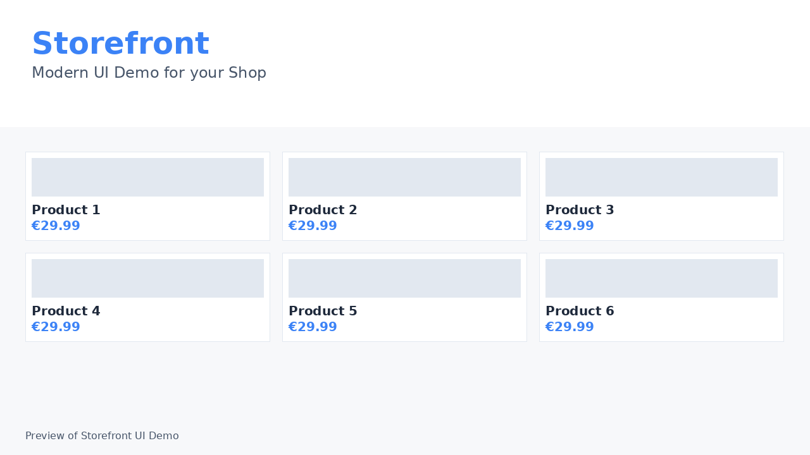

# Storefront UI Demo

A standalone e-commerce interface prototype built with HTML, CSS and vanilla JavaScript. It demonstrates a catalog page, a product page and client-side cart interaction, not a deployed shopping service.



## Run locally

```bash
git clone https://github.com/two-potato/storefront-ui-demo.git
cd storefront-ui-demo
python3 -m http.server 8000 --bind 127.0.0.1
```

Open http://127.0.0.1:8000/ in a browser. No backend, credentials or package installation is required.

## Implementation

- `index.html` and `product.html`: static views.
- `styles.css`: layout and presentation.
- `app.js`: interface interactions and cart-count updates.
- `cart-perekrestok.js`: quantity controls, browser-local cart persistence and custom events.

## Scope and limitations

The cart is local browser state, not a server-validated order. There is no authentication, checkout, payment, inventory integration or production SLA. No customer data is needed for the demo. Sample product presentation is illustrative; this project is not affiliated with any retailer.

## Browser regression tests

The cart validates persisted state, limits each SKU to 99 units and remains usable when localStorage writes are unavailable. The product layout switches to a single column on narrow screens. CI runs Chromium tests against the local static server, with no backend or payment calls. Search and category chips remain presentation controls, not a complete catalog search engine.

```bash
python3 -m pip install -r tests/requirements.txt
python3 -m playwright install chromium
python3 -m unittest discover -s tests -v
```
